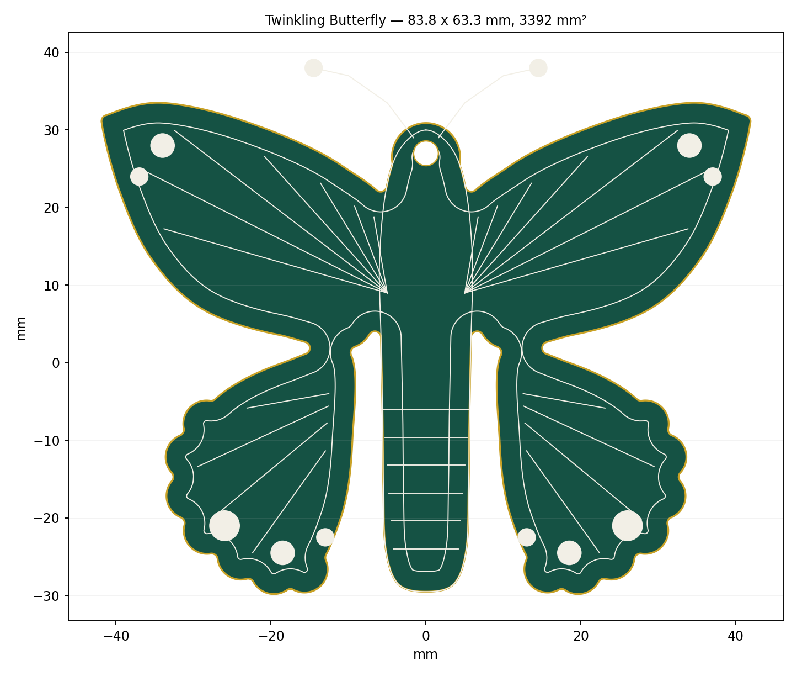
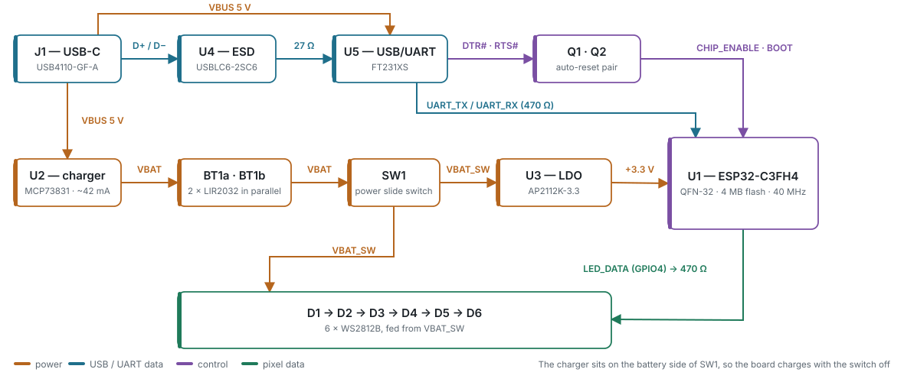

<h1 align="center">Twinkling Butterfly</h1>

<p align="center">
A butterfly-shaped PCB ornament with six addressable RGB LEDs that twinkle at night.<br>
Bare ESP32-C3, rechargeable coin cells, charged <em>and</em> reflashed over one USB-C port.<br>
No buttons. No programmer. No modules. All surface mount, nothing below 1206.
</p>

<p align="center">
  
</p>

<p align="center">
<b>83.8 × 63.3 mm</b> &nbsp;·&nbsp; 2 layers &nbsp;·&nbsp; 60 parts &nbsp;·&nbsp;
3–4 h per charge &nbsp;·&nbsp; <a href="LICENSE-HARDWARE">CERN-OHL-P</a> + <a href="LICENSE">MIT</a>
</p>

---

## How it works

<p align="center">
  
</p>

USB-C `VBUS` feeds an **MCP73831** charger (~42 mA) into two **LIR2032** cells in
parallel, and feeds the **FT231XS** bridge directly. The cells run through slide
switch **SW1** into an **AP2112K** regulator for the **ESP32-C3FH4**. The bridge's
DTR#/RTS# lines drive a cross-coupled transistor pair that pulls `CHIP_ENABLE`
and `BOOT`, so esptool resets the chip and enters the bootloader by itself.
GPIO4 drives the pixel chain from the *switched battery* rail, not the regulator.

Two consequences worth remembering:

- The charger sits on the battery side of SW1, so **the board charges with the switch off**.
- The ESP32 sits behind SW1, so **SW1 must be on to flash**.

## Build one

**Order boards.** `cd hardware && ./export_fab.sh --zip` produces gerbers, drill,
pick-and-place and a JLCPCB-shaped CPL. Upload `fab.zip`. Specs, and the three
things to check in the assembly preview, are in
[`docs/manufacturing.md`](docs/manufacturing.md).

**Solder it.** Everything is surface mount and nothing is finer than 1206 except
the QFN, the SSOP-20 and the USB-C shell — that is the whole design constraint.
Order of work and the pre-power checks are in
[`docs/assembly.md`](docs/assembly.md).

**Flash it.** Arduino IDE, `esp32` core, board **ESP32C3 Dev Module**,
`Adafruit NeoPixel` library, upload over the FT231XS COM port. Auto-reset handles
the rest.

**Change it.** Every generated file rebuilds from source:

```bash
pip install shapely matplotlib trimesh mapbox_earcut
cd mechanical && python3 butterfly_outline.py   # outline, silkscreen, previews
                 python3 make_3d.py             # STL for the board and a stand
cd ../hardware && python3 generate_sheets.py    # the three generated sheets
                  python3 validate_sheets.py    # netlist check — exit 0 is clean
                  python3 make_bom.py           # docs/bom.csv
                  python3 make_connections.py   # docs/connections.md
```

Edit the wing control points in `mechanical/butterfly_outline.py` and the shape,
the veins, the Edge.Cuts geometry and the 3D files all follow.

## Key numbers

| | |
|---|---|
| Board | 83.8 × 63.3 mm, 3392 mm², 2 layer, 1.6 mm |
| Min board width / internal radius | 5.4 mm / 0.8 mm — routable with a 1.5 mm bit |
| MCU | ESP32-C3FH4, bare QFN-32, 4 MB internal flash, 40 MHz crystal |
| Pixels | 6 × WS2812B on `VBAT_SW` (3.0–4.2 V), GPIO4 through 470 Ω |
| Battery | 2 × LIR2032 in parallel, ≈80 mAh |
| Charge | MCP73831, ~42 mA set by a 24 kΩ PROG resistor, ≈2.5 h from flat |
| Average draw | ≈12 mA — 10 % brightness, max 3 pixels lit, light sleep between frames |
| Runtime | 3–4 h per charge, then an 8 h auto-off deep sleep |
| Netlist | 41 nets, 60 references, checked on every commit |

> [!WARNING]
> **The cell retainers are LIR2032 only.** LIR2032 is rechargeable; the
> near-identical CR2032 is not. A CR2032 in this board with USB plugged in is a
> fire risk. Mark both retainers.

## What is in here

```
hardware/
  LED Butterfly/        the KiCad 10 project — 4 sheets, project symbol library, board
  generate_sheets.py    rebuilds the USB/UART, Power and LED sheets
  validate_sheets.py    re-parses the written files and rebuilds the netlist
  make_bom.py           BOM from the schematic
  make_connections.py   pin-by-pin tables from the schematic
  make_block_diagram.py the diagram above
  export_fab.sh         gerbers, drill, pick-and-place, BOM, STEP
mechanical/
  butterfly_outline.py  the shape, the silkscreen artwork, SVG/DXF/Edge.Cuts
  make_3d.py            butterfly_board.stl + a printable stand
firmware/
  butterfly_twinkle/    the Arduino sketch
docs/
```

| Document | |
|---|---|
| [bom.csv](docs/bom.csv) | 25 line items, 60 parts, with purchase links |
| [connections.md](docs/connections.md) | every pin of every device, its net, and what it lands on |
| [netlist.md](docs/netlist.md) | all 41 nets |
| [requirements.md](docs/requirements.md) | what it has to do, and how each is verified |
| [manufacturing.md](docs/manufacturing.md) | board spec, fab files, ordering |
| [assembly.md](docs/assembly.md) | hand-build order and pre-power checks |
| [power-and-charging.md](docs/power-and-charging.md) | the rails, the cells, the runtime arithmetic |
| [design-decisions.md](docs/design-decisions.md) | settled choices and why |
| [publishing.md](docs/publishing.md) | pushing this repo to GitHub |

## Status

Schematic complete and netlist-verified across all four sheets. Board outline and
silkscreen artwork done, parts placement proven to fit. **Next: footprint
assignment, then `Update PCB from Schematic` (F8) and routing.**
`mechanical/butterfly_placement.json` has a suggested centre for every major part.

## Licence

Hardware under [CERN-OHL-P v2](LICENSE-HARDWARE); firmware and scripts under
[MIT](LICENSE). Make them, sell them, change them — keep the notices.
